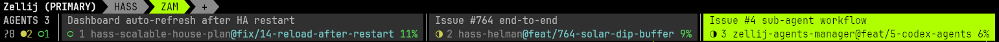
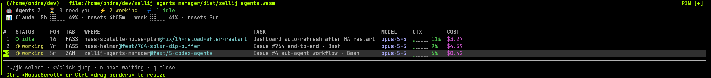

# zellij-agents

See every coding agent you run in Zellij, what it's doing, and jump to it in one key.



## Supported agents

| agent | works out of the box | the optional status line adds |
|---|---|---|
| Claude Code (2.1.295 or newer) | state, activity, notifications, title, repo@branch, model, context %, usage line | cost |
| Codex CLI (0.163 or newer) | state, activity, notifications, title, repo@branch, model, context %, usage line | (nothing: Codex reports no cost) |
| agy (Antigravity CLI, 1.4 or newer) | state, activity, notifications, repo@branch | title, model, context %, cost, usage line |
| Cursor CLI | working/idle guessed from its chat writes, repo, model | context % (Cursor reports no state, so no "needs you" and no notifications) |
| any other agent that reports to Zellij (OpenCode, Copilot CLI, …) | state, activity, notifications | – |

The agents' state comes from Zellij itself: Claude Code, Codex and agy report it to Zellij 0.46 with no setup (see Zellij's [Inbox](https://zellij.dev/documentation/inbox.html)). zellij-agents adds what Zellij doesn't know. `./setup.sh` detects which agents you have and offers their status lines.

## Features

- A bar under the tab bar, on every tab, with one chip per agent.
- Status per agent, as Zellij's tab markers and Inbox show it (needs you, failed, done, working, idle), with its context %.
- Click a chip or press `Ctrl+Alt+1…9` to jump to that agent's pane; `Ctrl+Alt+←/→` goes to the previous/next one.
- A panel (`Ctrl+Alt+0` or click `AGENTS`) with each agent's model, context and cost, and your account's usage limits.
- Agents in your other Zellij sessions show up too, and you can jump to them.
- A desktop notification when an agent needs you, finishes or fails.



## Install

Needs Zellij 0.46 or newer and `python3` (plus `jq` for the agent status lines). Rust is not needed.

1. Clone the repo:
   ```sh
   git clone https://github.com/Scarfsail/zellij-agents-manager.git && cd zellij-agents-manager
   ```
2. Run the setup and pick what you want with ↑/↓ and enter. It detects your agents and offers their status lines.
   ```sh
   ./setup.sh
   ```
3. Start a new Zellij session. The bar asks for permissions: click it and press `y`.

Re-run `./setup.sh` any time to change or remove things; `./setup.sh --status` shows what is installed.

Tip: `Ctrl+Alt+<digit>` needs a terminal with the kitty keyboard protocol (WezTerm: `config.enable_kitty_keyboard = true`; kitty, foot, ghostty and recent Alacritty do it by default).

## Usage

| key | action |
|---|---|
| `Ctrl+Alt+1` … `Ctrl+Alt+9` | jump to agent n of the bar |
| `Ctrl+Alt+0` | toggle the agents panel (same as clicking `AGENTS`) |
| `Ctrl+Alt+←` / `Ctrl+Alt+→` | previous / next agent, wrapping around |
| panel: `j`/`k` or `↑`/`↓` | select |
| panel: `enter` or click | jump |
| panel: `n` | jump to the next agent that needs you (then failed, done, idle) |
| panel: `q` or `esc` | close |

Keys are shown with the `Ctrl+Alt` modifier. `./setup.sh` suggests the one your Zellij mode keys already use and lets you pick another.

## Uninstall

Run `./setup.sh` and choose Remove on the layouts and on each agent's status line, or by hand: `scripts/install.sh --uninstall` and each agent script's `--uninstall` (see [Development](#development)).

### Upgrading from a version with hooks

Older versions installed hooks into Claude Code, Codex and Cursor. They are no longer needed and do nothing now: `./setup.sh` shows `⚠ old ZAM hooks  remove ›` under each agent that still has them; enter removes them (or run the agent's script with `--uninstall-hooks`). Until then the agents keep working with them.

---

## How it works

One WASM binary (`dist/zellij-agents.wasm`, committed) runs in two modes: `bar` and `panel`.

### Bar

A 2-row strip under the native tab bar. The block on the left (` AGENTS N `) counts the agents by status and toggles the panel. Each chip shows the session title on the first row and, in softer grey below it, the status icon, agent number, repo@branch (the `@branch` in cyan) and context % (green up to 50%, orange above and red above 80%). The status icon keeps its status colour.

- The status icons are Zellij's: `●` needs you, `✗` failed, `✓` done, `◐` working (spinning) and `○` idle. Zellij's "new output" and "went quiet" on an agent pane count as idle. The header block counts each. Their colors come from your Zellij theme, the same ones Zellij uses.
- A chip that needs you pulses amber until Zellij marks the pane seen (you look at it); after that only the `●` blinks, until it asks something new.
- A muted agent (`Ctrl p u`, or a muted tab or session) keeps its status icon, but its chip is dimmed and never pulses or blinks.
- The focused agent's chip uses Zellij's active-tab colours (reverse video only as a fallback) with a bold icon, and drops the grey, cyan and ctx colours except a red ctx. A pulsing chip drops all of them, ctx included, since red on amber is unreadable.
- `↗` marks an agent in another Zellij session.

### Panel

A header, a table and a footer, split by thin rules.

- **Header**: the agent counts (`🤖 Agents 4   ⏳ 1 need you   ❌ 0 failed   ✅ 1 done   ⚡ 1 working   💤 1 idle`) and one usage line per vendor, either `📊 Claude  credits $513.35 / $750.00 · ⣿⣿⣿⣀⣀ 68% · resets Dec 1` (usage-based plans, the amounts in magenta) or `📊 Claude  5h ⣿⣿⣀⣀⣀ 48% · resets 2h10m   week ⣿⣀⣀⣀⣀ 23% · resets Mon` (subscriptions); `usage n/a (login expired)` when it can't be fetched.
- **Meters** are 5 braille cells that fill by pairs of dots, bottom to top (⣀ ⣤ ⣶ ⣿, 4 steps per cell, so 5% per step), on a dim ⣀ track for the cells not reached yet. A usage meter and its % turn yellow from 60 and red from 80.
- **Table**, one line per agent: `#` (agent number), `STATUS` (icon + label), `FOR` (time in that status), `TAB` (tab name in light grey, `↗session` for another Zellij session), `WHERE` (repo@branch, `@branch` in cyan), `TASK` (session title plus the activity Zellij reports, e.g. `needs approval: Bash`), `MODEL` (lavender), `CTX` (meter and %, coloured as on the bar, or the uncoloured raw token count when the % is unknown) and `COST` (the session's `$` so far in magenta, `-` until known).
- **Layout**: columns are as wide as their content (WHERE, TAB and MODEL capped). TASK takes the width left over and is dropped when the pane is too narrow; after that WHERE, TAB and MODEL narrow down to 8 cells before anything is cut. Below about 70 columns trailing columns may still be cut.
- **Footer**: the keys, or an error, which keeps the last line even when the pane is too short for the footer.

The bar opens the panel as its own pinned floating pane right below itself, full width and sized to the agents, with the bar's config and `mode=panel`. Other floating panes of the tab are tucked away while it is open and come back when it closes. The panel starts with the selection on the agent you were focused on.

### How detection works

The agents' state is Zellij's. An agent prints it into its pane with an `OSC 7501` escape sequence and Zellij tracks it per pane in every session (tab markers, frame titles, the Inbox). The plugin reads it from `PaneUpdate` (`PaneInfo.attention`, `program_status`) for this session and `GlobalAttentionUpdate` for the others, where a pane that reported once stays listed while idle. Status, activity, the seen mark and mute all come from there. Any pane whose program reports with an `app` name is an agent, so agents zellij-agents knows nothing about show up too, with `-` for the extras.

The plugin also runs `scripts/zam-scan.py` every 2 s via `run_command` for what Zellij doesn't know, and joins its agents to Zellij's by (session, pane). For Claude Code it:

1. reads `~/.claude/sessions/<pid>.json` (Claude Code writes `cwd`, `name`, `startedAt`),
2. drops dead processes (checks `/proc/<pid>/stat` start time against `procStart` to survive pid reuse),
3. reads `ZELLIJ_PANE_ID` from `/proc/<pid>/environ` and finds the agent's session by walking up to the Zellij server process it runs under. `ZELLIJ_SESSION_NAME` is frozen at start and goes stale when a session is renamed; the current name is the server's socket file name, matched to the server pid via `SO_PEERCRED` once a rename is detected, so the extras stay on the right agent after a rename,
4. computes context usage the way Claude Code does for the statusline's `used_percentage`: tokens of the last request (`input + cache_read + cache_creation` from the transcript) over that model's `max_input_tokens` from Claude Code's model catalog cache (`~/.claude/cache/model-catalog/`), rounded and clamped to 0–100, honouring `CLAUDE_CODE_MAX_CONTEXT_TOKENS` + `DISABLE_COMPACT` from the agent's env. If a model isn't in the catalog, the raw token count is shown instead of a guessed %.

The plugin joins this with `PaneUpdate`/`TabUpdate` to learn the tab and the pane title (Claude puts the task summary there), and jumps with `focus_terminal_pane` (switches tab, unstacks, shows floating). Agents in another Zellij session jump via `focus_session_pane`.

**Claude status line** (`scripts/install-hooks.sh`): wraps Claude Code's status line (`statusLine.command` in `~/.claude/settings.json`) with `zam-scan.py --claude-statusline`, which records each session's cost (`cost.total_cost_usd`) in `~/.cache/zellij-agents/claude/<session>.status.json` for the COST column; the scanner drops the record once the session has ended. Your previous status line command is kept after `--`, gets the same input and its output is still shown; if you had none, the installed one prints nothing. Re-running is safe; it keeps a `settings.json.zam.bak` backup and `--uninstall` undoes it.

**Claude usage line**: from the endpoint Claude Code's `/usage` reads (`api.anthropic.com/api/oauth/usage`), called with your local Claude login (`~/.claude/.credentials.json`). The scanner refreshes it in the background at most once a minute into `~/.cache/zellij-agents/usage/claude.json`, so a scan never waits on the network; the token is only sent in the request, never stored or logged. The endpoint is undocumented: if it changes, the line shows `usage n/a` until the scanner is adapted. An expired login shows `usage n/a (login expired)` until Claude Code refreshes it.

All agent install scripts are idempotent, keep `.zam.bak` backups, keep your own status line chained and undo with `--uninstall`, which also strips the hooks older versions added (`--uninstall-hooks` strips only those). Restart running agents after installing. Pane and session always come from the agent's environment, as for Claude.

### Cursor

Cursor CLI (`cursor-agent`) writes no live session file and reports no state to Zellij, so the scanner finds its processes in `/proc` (cmdline contains `cursor-agent/versions/…/index.js`) and follows the `~/.cursor/chats/<hash>/<agentId>/store.db` each one keeps open to the chat's `meta.json` (cwd) and the `store.db` meta row (agent id, name, last model). It is the one agent whose state is guessed: working while its `store.db` was written in the last 4 s, else idle. It never shows NEEDS YOU and raises no notifications, since the guess would flap.

`scripts/install-cursor.sh` adds the **status line** in `~/.cursor/cli-config.json` (`zam-scan.py --cursor-statusline`), which records Cursor's own context % in `~/.cache/zellij-agents/cursor/<agent pid>.json`; the status line process finds its agent by walking up its parent processes. An existing status line command is chained (same input, output still shown); if you had none, Cursor's status line area stays blank.

### Codex

Codex CLI writes no live session file either. The scanner finds its TUI processes in `/proc` (the native `codex` binary, not the `node` wrapper; non-interactive subcommands such as `exec` and the shared `app-server` daemon are skipped) and links each one to the newest interactive thread (`originator` `codex-tui`, not a subagent's) in `~/.codex/state_5.sqlite` with the same working directory, updated since the process started. The thread gives the title, branch and model; the tail of its rollout log (`~/.codex/sessions/…/rollout-*.jsonl`) gives the context %, computed like Codex's own "context left" (the last request's tokens over the model's window, both less Codex's 12 000-token baseline). Its state comes from Zellij (Codex 0.163 or newer; an older Codex shows idle). A freshly started TUI has no thread until its first prompt. Two Codex TUIs in the same directory may both show the newer thread: the process carries nothing that names its thread. Codex logs no cost, so COST stays `-`.

The `📊 Codex` usage line shows the 5h and weekly limits from the `rate_limits` Codex logs with each response in the newest rollout, so it needs no login token and no network call. A window whose reset has passed is dropped until Codex logs fresh numbers.

Codex needs no setup. `scripts/install-codex.sh --uninstall` only strips the hooks older versions added to `~/.codex/hooks.json`.

### agy

agy (Antigravity CLI) writes no readable live state: its conversations are protobuf blobs in `~/.gemini/antigravity-cli/conversations/<id>.db`. The scanner finds its TUI processes in `/proc` (the `agy` binary, or `agy.<n>.old` after agy updated itself while running; subcommands such as `mcp` or `models`, print mode `-p`/`--print`/`--prompt` and the `--bg-updater` it starts are skipped). The working directory comes from the process and its branch from the repo's `.git/HEAD`. Its state comes from Zellij (agy 1.4 or newer; with `AGY_CLI_OSC7501=off` it shows idle). Without setup it has no title (the pane title is shown), model, context or cost.

`scripts/install-agy.sh` wraps the status line (`statusLine.command` in `~/.gemini/antigravity-cli/settings.json`) with `zam-scan.py --agy-statusline`. agy feeds it a documented JSON whenever its state changes, which gives:

- the conversation title, model, context % and COST (agy's own estimate),
- the `📊 Agy` usage line: one meter per quota bucket as in agy's `/usage` (`gemini 5h`, `gemini week`, `argon week`, `3p 5h`, `3p week`, where `3p` is the Claude and GPT group; a disabled bucket is left out), from `~/.cache/zellij-agents/usage/agy.json`, dropped after a day without agy.

An existing status line command is chained (same input, output still shown); if you had none, the installed one is stacked below agy's built-in status line (`stack_with_default`), which keeps showing. The status line process finds its agent by walking up its parent processes and writes `~/.cache/zellij-agents/agy/<agent pid>.json`. The title, model, context %, COST and the usage line need the status line.

### Notifications

The bar raises a system notification when an agent enters needs you (`Claude needs you`), done (`Codex finished`) or failed (`Agy failed`) in Zellij, naming repo@branch, the task and, for needs you and failed, what Zellij reports (e.g. `needs approval: Bash`). An agent zellij-agents doesn't know is named after the app it reports (`Opencode needs you`). The bar passes Zellij's states to the scanner (`--native`), which records each pane's last state in `~/.cache/zellij-agents/notify/` and claims each change there, so bars in several tabs and sessions notify once, and agents that were already waiting or done when the bars started don't notify at all.

- A muted agent (pane, tab or session muted in Zellij) never notifies.
- Cursor never notifies: it reports no state, and the guessed one would flap.

- **WSL**: a Windows toast via `powershell.exe`, skipped while the terminal is the foreground window (recognised: WezTerm via `TERM_PROGRAM`, Windows Terminal via `WT_SESSION`; any other terminal always notifies). The terminal is read from the environment the Zellij server was started in, so a session attached later from a different terminal, or started detached, isn't suppressed correctly.
- **Linux**: `notify-send`, which always notifies, since there is no portable way to tell whether the terminal is focused.

Set `notify false` in the bar's plugin config to turn it off.

### Layout and jump keys

`scripts/install.sh` generates `~/.config/zellij/layouts/agents.kdl` + `agents.swap.kdl` from Zellij's own default layout and swap layouts, with the bar added under the tab bar, and sets `default_layout "agents"` in `config.kdl`. The layout points at this checkout, so `plugin/build.sh` updates new sessions directly. Existing sessions keep their layout; start a new session (or `zellij action new-tab --layout agents`) to get the bar. If there is no `config.kdl` yet, one is created holding only the jump keys (Zellij's defaults stay in effect). If `config.kdl` sets another `default_layout`, the script installs the keys and layouts and asks you to switch the layout yourself; `./setup.sh` can switch it for you, keeping your line as a `// zellij-agents replaced: …` comment that `--uninstall` / `--no-default-layout` put back.

On first start the bar asks for permissions (read state, change state, run commands, open panes for the panel under the bar). Zellij remembers this per plugin path; bars already open in other tabs ask once too.

The jump keys are lines tagged `// zellij-agents` in `config.kdl` (re-running replaces them, `--uninstall` removes them). `scripts/install.sh` defaults to `Ctrl Alt`; `./setup.sh` defaults to the modifier your Zellij mode keys use (the one on `SwitchToMode "pane"` in normal mode: `Ctrl` in stock Zellij), falling back to `Ctrl Alt` when it finds none. `./setup.sh` marks a modifier whose jump keys would shadow an existing bind in normal or locked mode with ⚠ and asks before using it. Legacy terminal encoding can't express Ctrl with a digit, hence the kitty keyboard protocol.

Each key broadcasts a message to all plugins:

```kdl
bind "Ctrl Alt 1" { MessagePlugin { name "zam_jump"; payload "1"; }; }
```

Only the bar in the tab you are looking at acts on it, so one press is one jump. Payloads: `1`–`9`, `left`, `right`, `panel` (toggle the panel), and `next` (next agent that needs you, then failed, done and idle ones, skipping muted agents; no default key). Numbers follow the bar order: agents in this session by tab, top-to-bottom and left-to-right within a tab, then agents in other sessions.

A key of your own for the panel should go through the bar with the `panel` payload, since only the bar knows which agent you were focused on (add to the `shared_except "locked"` block of `config.kdl`):

```kdl
bind "Alt a" { MessagePlugin { name "zam_jump"; payload "panel"; }; }
```

### Setup screen

`./setup.sh` shows four groups: **Requirements** (Zellij and its version, `jq`, the plugin build), **Zellij integration** (the layouts, `default_layout`, the jump keys and their modifier), **Bar options** (`notify` / `interval` / `hide_on_jump`) and **Supported agents** (the status line of each, `⚠ old ZAM hooks  remove ›` when hooks from an older version are still there, plus its binary, version and config directory; an agent is found when its binary is on `PATH` or its config directory exists, the others are "not found"). Settings show their value in `[brackets]` followed by `›`; the cursor skips information lines. ✓ marks what is installed or on, ⚠ a warning (stale, a key clash, old hooks), ✗ a missing requirement (or Zellij older than 0.46) and ○ off or not installed. ↑/↓ (or j/k) and enter to change a setting; q or esc goes back. `--status` prints the same groups, coloured only on a terminal and without `NO_COLOR`. Changing nothing changes no file. Everything is read back from `config.kdl`, `agents.kdl` and the agents' settings files, so manual edits and runs of the scripts show up too, and anything pointing at a different checkout is marked "stale". The changes themselves are made by the scripts under [Development](#development).

### Config

Plugin options, set in the bar's plugin block in `agents.kdl` (via `./setup.sh` or `scripts/install.sh --opt`):

| key | default | |
|---|---|---|
| `mode` | `bar` | `bar` or `panel` |
| `scanner` | `zam-scan.py` | absolute path, or `~/…` |
| `interval` | `2` | seconds between scans |
| `hide_on_jump` | `true` | panel closes itself after jumping |
| `notify` | `true` | bar: system notification when an agent needs you, finishes or fails (see *Notifications*) |
| `debug_dump` | – | write each rendered frame to this path |

## Development

### Build

```sh
plugin/build.sh     # -> dist/zellij-agents.wasm
```

The plugin source (Rust crate) lives in `plugin/`; the built `dist/zellij-agents.wasm` is committed. Needs rustup + `wasm32-wasip1`. Without a system C compiler it uses zig from `~/.local/share/zam-zig` as the host linker (`sudo apt install build-essential` removes the need).

Zellij reloads `config.kdl` in running sessions by itself. To load a new build into bars that are already running:

```sh
# run from the checkout; must match the bar config scripts/install.sh wrote into the layout
zellij action start-or-reload-plugin -c "mode=bar,scanner=$PWD/scripts/zam-scan.py" "file:$PWD/dist/zellij-agents.wasm"
```

The configuration must match the layout's exactly, or Zellij starts a new instance instead.

### Try it without installing

Bar in every tab (new session with this layout):

```sh
scripts/install.sh --layouts-only   # writes ~/.config/zellij/layouts/agents.kdl pointing at this checkout
zellij --layout agents
```

Panel as a floating window in the current session:

```sh
# run from the checkout
zellij plugin --floating --configuration "mode=panel,scanner=$PWD/scripts/zam-scan.py" -- "file:$PWD/dist/zellij-agents.wasm"
```

Zellij asks for permissions on first load; press `y`.

### Install by hand

`setup.sh` drives these scripts, which stay the non-interactive way to do the same: `scripts/install.sh` for Zellij and `scripts/install-hooks.sh` (Claude's status line), `scripts/install-cursor.sh`, `scripts/install-agy.sh` for the agents (each takes `--uninstall`; Claude's and Cursor's also `--uninstall-hooks`), and `scripts/install-codex.sh --uninstall` to strip old Codex hooks.

```sh
scripts/install.sh                     # layouts/agents.kdl + agents.swap.kdl in ~/.config/zellij/layouts, default_layout "agents" and jump keys in config.kdl
scripts/install.sh --mod "Alt"         # jump keys on another modifier (default "Ctrl Alt")
scripts/install.sh --opt notify=false  # a line in the bar's plugin config (repeatable; key= removes it)
scripts/install.sh --no-default-layout # layouts + jump keys; removes our default_layout "agents" line
scripts/install.sh --layouts-only      # only the layouts; config.kdl untouched
scripts/install.sh --uninstall         # undo
```

Plugin options already in `agents.kdl` (`notify false`, or any you added by hand) are carried over when `scripts/install.sh` regenerates the layouts, so a plain re-run keeps them; `--opt` sets or removes one on top.

### Tests

```sh
python3 -m unittest discover tests
```
